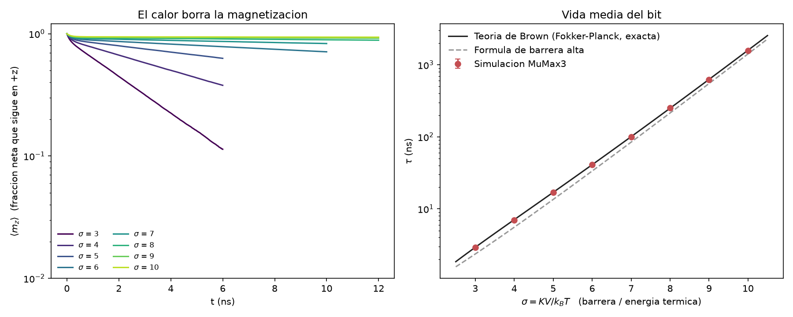
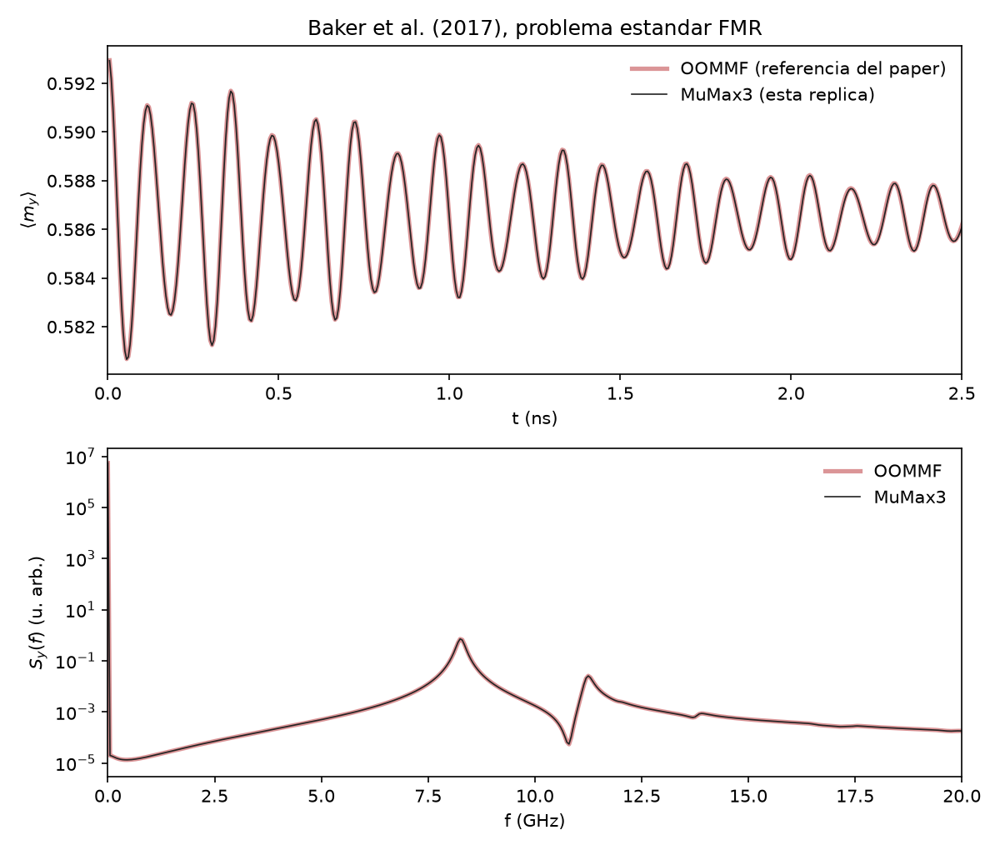
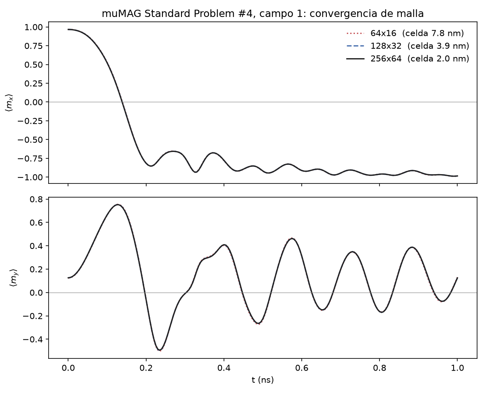
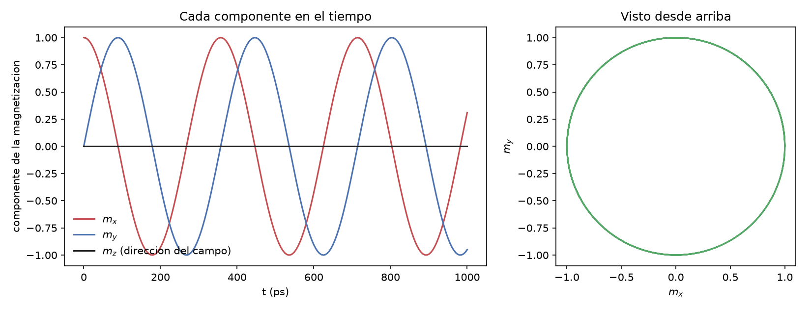

# spinlab


Simulaciones micromagnéticas en GPU con [MuMax3](https://mumax.github.io/), cada una
**validada contra algo externo**: una fórmula analítica, un problema estándar de la
comunidad o los datos publicados de un paper.

No hay física nueva aquí. El objetivo es el método: antes de confiar en una simulación
para una pregunta abierta, hay que demostrar que reproduce las preguntas ya resueltas.
Cada experimento trae su referencia, sus controles numéricos y un test automático que
falla si el resultado deja de coincidir.

| # | Experimento | Se compara contra | Resultado |
|---|---|---|---|
| 1 | Precesión de Larmor | Fórmula analítica, T = 2π/(γB) | 357.10 ps contra 357.10 ps |
| 2 | µMAG Standard Problem #4 | Test oficial de MuMax3 | Diferencia < 1e-5; convergencia de orden 2 |
| 3 | Resonancia ferromagnética (Baker et al., 2017) | Datos OOMMF de los autores | Los 5 picos coinciden (resolución 0.05 GHz) |
| 4 | Vida térmica de un bit (Néel-Brown) | Solución exacta de Fokker-Planck | Coincide dentro de 1.5 % en 8 temperaturas |

## 4. Cuánto dura un bit magnético contra el calor

Es el experimento principal. Una partícula magnética con un eje preferido guarda un bit:
magnetización arriba o abajo. El calor la empuja al azar y, tarde o temprano, la voltea.
La pregunta es cuánto tarda.

El parámetro que manda es σ = KV / k<sub>B</sub>T: la barrera de energía entre los dos
estados dividida entre la energía térmica.

**Diseño.** En lugar de repetir una simulación miles de veces, se simulan 262 144
partículas idénticas e independientes en una sola corrida (grilla de 512 × 512 sin
intercambio ni campo dipolar). Todas empiezan hacia arriba y la magnetización media
decae como exp(−t/τ). Se mide τ a ocho temperaturas.

**Teoría.** La ecuación de Fokker-Planck de Brown (1963) se resuelve numéricamente en
`spinlab/teoria.py`, en base de polinomios de Legendre, sin usar MuMax3. Son dos caminos
independientes hacia el mismo número.



| σ | T (K) | τ simulación (ns) | τ teoría (ns) | cociente |
|---|---|---|---|---|
| 3 | 301.8 | 2.913 ± 0.010 | 2.922 | 0.997 |
| 4 | 226.3 | 7.009 ± 0.020 | 7.074 | 0.991 |
| 5 | 181.1 | 16.98 ± 0.13 | 16.96 | 1.001 |
| 6 | 150.9 | 41.03 ± 0.12 | 40.99 | 1.001 |
| 7 | 129.3 | 99.2 ± 0.9 | 100.4 | 0.988 |
| 8 | 113.2 | 251 ± 6 | 250 | 1.008 |
| 9 | 100.6 | 623 ± 5 | 627 | 0.992 |
| 10 | 90.5 | 1571 ± 51 | 1593 | 0.986 |

Las barras de error salen de partir la grilla en cuatro cuadrantes independientes.

**Controles.**

- *Paso de tiempo:* repetir σ = 5 con la mitad del paso cambia τ en 0.9 %.
- *Sin barrera:* con K = 0 la teoría se reduce a una sola fórmula. La simulación da
  688.7 ± 4.8 ps contra 692.9 ps.

**Lo que se aprende.**

- Enfriar de 302 K a 91 K (un factor 3.3) alarga la vida del bit unas 540 veces.
- La fórmula de barrera alta de los libros de texto se equivoca entre 10 y 20 % en este
  rango de σ. Hace falta la solución exacta.
- Extrapolando la teoría (esto **no** está simulado): retener datos más de 10 años pide
  σ ≈ 45, que con este material a 300 K equivale a un cubo de unos 12 nm.

**Un error que vale la pena contar.** La primera comparación dio una simulación
exactamente 2.00 veces más lenta que la teoría, en los ocho puntos. El error estaba en
el álgebra de la teoría (τ<sub>N</sub> confundido con 2τ<sub>N</sub>), no en el simulador.
El control sin barrera existe precisamente para distinguir esos dos casos sin "ajustar
hasta que calce".

**Limitaciones.** Partículas sin interacción entre sí; cada una tratada como un solo
espín rígido; parámetros de material plausibles pero no medidos; barrido hasta σ = 10.

## 3. Resonancia ferromagnética

Réplica de las figuras 2 y 3 de Baker et al., *J. Magn. Magn. Mater.* 421, 428 (2017).
Una lámina de permalloy de 120 × 120 × 10 nm se perturba girando ligeramente el campo
aplicado, y el espectro de potencia de la magnetización media revela sus modos.



Picos en 8.25, 11.25, 13.9, 17.3 y 17.55 GHz, idénticos a la referencia. La comparación
es entre códigos distintos: los autores usaron OOMMF y aquí se usa MuMax3. Solo se
replica el método 1 del paper (promedio espacial); faltan los mapas de modos.

## 2. µMAG Standard Problem #4

Inversión de una lámina de permalloy de 500 × 125 × 3 nm, con tres tamaños de celda.



| Malla | Celda (nm) | Primer cruce por cero de ⟨m<sub>x</sub>⟩ (ps) |
|---|---|---|
| 64 × 16 | 7.8 | 139.17 |
| 128 × 32 | 3.9 | 138.66 |
| 256 × 64 | 2.0 | 138.53 |

El error cae unas 4 veces al partir la celda a la mitad: convergencia de segundo orden.

## 1. Precesión de Larmor

Un solo espín perpendicular a un campo de 0.1 T, sin amortiguamiento. Gira alrededor del
campo a 2.80 GHz y nunca se alinea con él.



## Cómo usarlo

```bash
pip install -e ".[dev]"
pytest -q
```

Las tablas de salida de MuMax3 están versionadas en `datos/`, así que los tests y las
figuras **no necesitan GPU**:

```bash
python -m spinlab.neel
```

Para volver a simular desde cero hace falta MuMax3 y una GPU NVIDIA:

```bash
python -m spinlab.neel --simular
```

Si `mumax3` no está en el PATH, define la variable de entorno `MUMAX3` con la ruta al
ejecutable. El barrido térmico completo tarda unos 15 minutos.

Los módulos son `spinlab.larmor`, `spinlab.sp4`, `spinlab.fmr` y `spinlab.neel`. El
script `.mx3` exacto de cada corrida queda guardado junto a su tabla en `datos/`.

## Entorno

MuMax3 3.12 (CUDA 12.9) en una NVIDIA RTX 5070, Windows 11, Python 3.12.

Dos detalles de MuMax3 que costaron una corrida cada uno:

- `tableautosave()` no guarda en instantes exactos, sino en el primer paso del solver
  que pasa cada marca. Para una FFT hay que avanzar con `run(dt)` y `tablesave()`.
- En problemas muy suaves el solver adaptativo da pasos más largos que el intervalo de
  muestreo. Se limita con `MaxDt`.

## Referencias

- A. Vansteenkiste et al., "The design and verification of MuMax3", *AIP Advances* 4, 107133 (2014).
- W. F. Brown, "Thermal fluctuations of a single-domain particle", *Phys. Rev.* 130, 1677 (1963).
- A. Baker et al., "Proposal of a micromagnetic standard problem for ferromagnetic resonance simulations", *J. Magn. Magn. Mater.* 421, 428 (2017).
- µMAG Standard Problem #4, NIST: https://www.ctcms.nist.gov/~rdm/std4/spec4.html

## Licencia

MIT.
